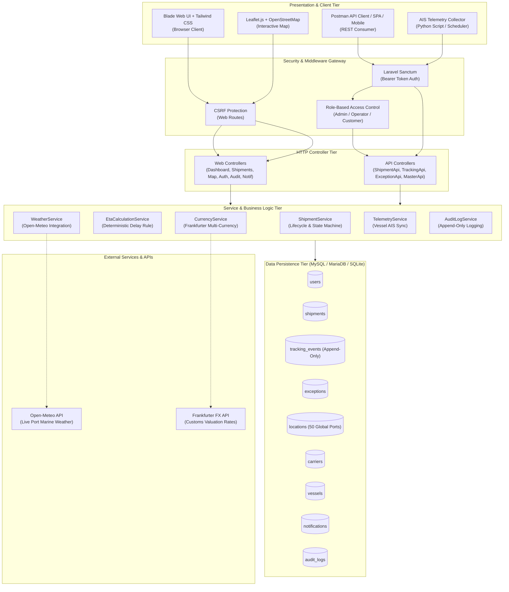
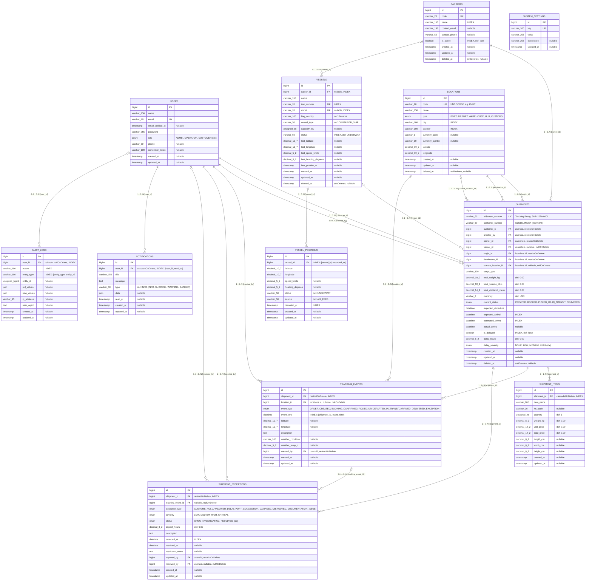
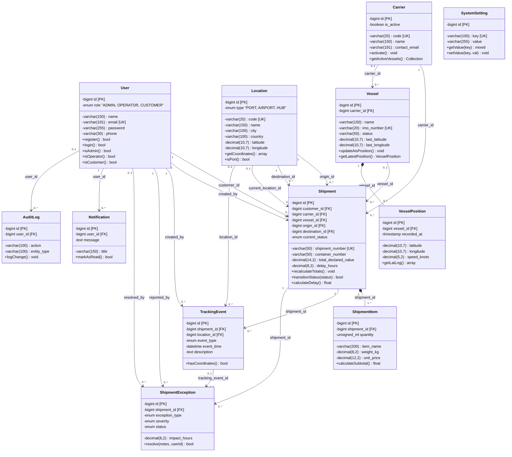
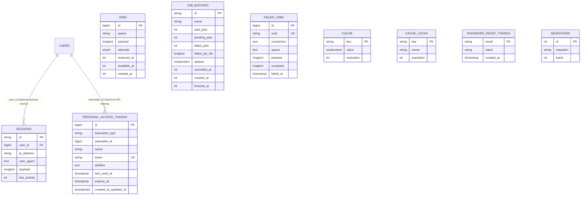
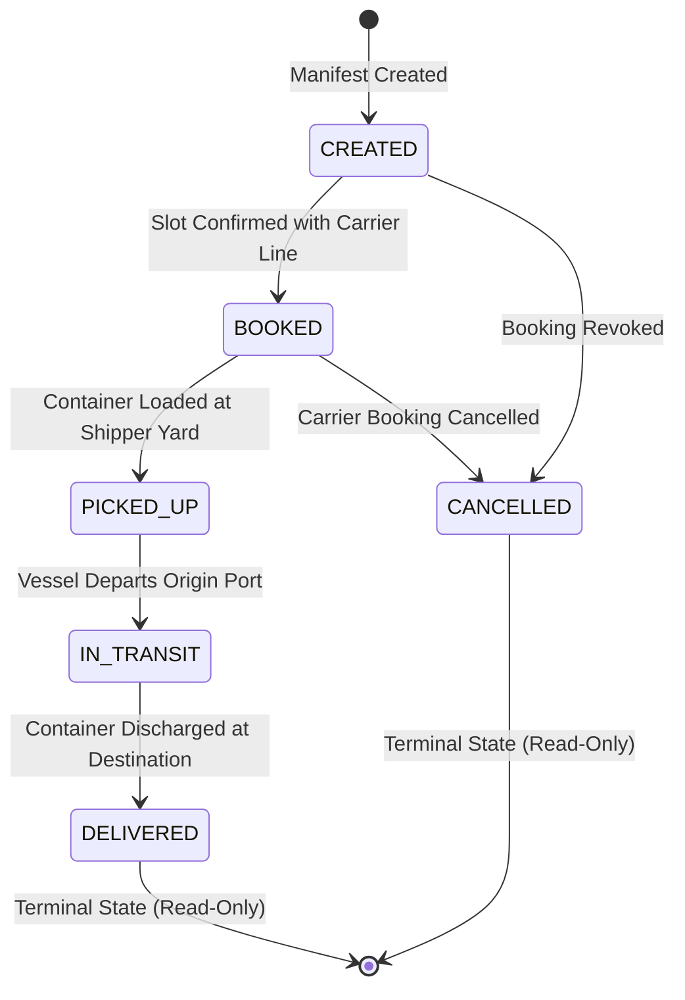

# CargoTrace — Architecture & Entity-Relationship Documentation (ERD)

This document provides the complete technical architectural design, domain model, database schema, data dictionary, and security specifications for the **CargoTrace Global Maritime Shipment Visibility & Automated Tracking Platform**, in full compliance with the Web Programming 2 final project brief.

---

## 1. System Architecture Diagram

CargoTrace adheres to a clean, decoupled multi-tier Laravel architecture leveraging the **Controller-Service-Repository** design pattern. It enforces strict separation of concerns between HTTP presentation, domain logic, data persistence, and external third-party integrations.

---

## 2. Entity-Relationship Diagrams (ERD)

Untuk menjaga keterbacaan (*readability*) dan fokus arsitektur sistem pada laporan UAS, skema basis data dibagi menjadi dua diagram:
1. **ERD 1 — Core CargoTrace (12 Tabel Domain Aplikasi)**: Diagram utama yang merepresentasikan rancangan proses bisnis logistik maritim.
2. **ERD 2 — Laravel Infrastructure (9 Tabel Pendukung Framework)**: Diagram pendukung untuk layanan internal framework Laravel (auth tokens, sessions, job queue, caching, migrations).

---

### 2.1 ERD 1 — Core CargoTrace (Domain Utama — 12 Tabel Aplikasi)

Diagram ini adalah diagram ERD relasional fisik (*Physical Database ERD*) aktual hasil audit migrasi Laravel. Tabel `SHIPMENTS` diposisikan sebagai entitas sentral (*central aggregate root*), dikelilingi oleh entitas master data (`USERS`, `CARRIERS`, `VESSELS`, `LOCATIONS`) dan entitas transaksional detail (`SHIPMENT_ITEMS`, `TRACKING_EVENTS`, `SHIPMENT_EXCEPTIONS`, `VESSEL_POSITIONS`, `NOTIFICATIONS`, `AUDIT_LOGS`, `SYSTEM_SETTINGS`).

Setiap garis relasi dilengkapi dengan:
- **Simbol Crow's Foot Fisik**: `||` (Exactly 1), `|o` (0 or 1), `o{` (0 or Many), `|{` (1 or Many).
- **Anotasi Kardinalitas Teks**: Menampilkan jumlah rasio di kedua ujung relasi (misal `1 : 0..N` atau `0..1 : 0..N`) beserta nama Foreign Key.

---

### 2.2 UML Class Diagram (Logical Object Model ERD)

Representasi berorientasi objek (*Object-Oriented Data Model*) dengan format kotak 3-sekat (nama kelas, atribut kolom, dan method Eloquent) serta kardinalitas eksplisit di kedua ujung garis:

---

### 2.3 ERD 2 — Laravel Infrastructure (Framework & System Tables)

Diagram ini mendokumentasikan 9 tabel pendukung bawaan Laravel 11 untuk penanganan sesi web, autentikasi REST API (Sanctum), antrean background jobs (*queueing*), penyimpanan cache, reset kata sandi, dan migration history.

---

## 3. Data Dictionary

### Table: `shipments`
Main operational ledger storing container shipments, assigned vessels, valuations, and automated delay metrics.

| Column | Type | Nullable | Key | Description |
|---|---|---|---|---|
| `id` | `BIGINT UNSIGNED` | No | PK | Auto-increment primary key |
| `shipment_number` | `VARCHAR(50)` | No | UNIQUE | Public tracking identifier (e.g. `SHP-2026-0001`) |
| `container_number` | `VARCHAR(50)` | Yes | INDEX | ISO 6346 container serial (e.g. `MSKU8291024`) |
| `customer_id` | `BIGINT UNSIGNED` | No | FK | References `users.id` (Customer who owns shipment) |
| `created_by` | `BIGINT UNSIGNED` | No | FK | References `users.id` (Operator who registered shipment) |
| `carrier_id` | `BIGINT UNSIGNED` | No | FK | References `carriers.id` |
| `vessel_id` | `BIGINT UNSIGNED` | Yes | FK | References `vessels.id` |
| `origin_id` | `BIGINT UNSIGNED` | No | FK | References `locations.id` (Port of Loading) |
| `destination_id` | `BIGINT UNSIGNED` | No | FK | References `locations.id` (Port of Discharge) |
| `current_location_id` | `BIGINT UNSIGNED` | Yes | FK | References `locations.id` (Last known checkpoint) |
| `cargo_type` | `VARCHAR(100)` | No | - | Goods commodity description |
| `total_weight_kg` | `DECIMAL(10,2)` | No | - | Total gross weight in kilograms |
| `total_volume_cbm` | `DECIMAL(10,2)` | No | - | Total volume capacity in cubic meters |
| `total_declared_value` | `DECIMAL(14,2)` | No | - | Declared valuation for customs and insurance |
| `currency` | `VARCHAR(3)` | No | - | ISO 4217 Currency Code (default `USD`) |
| `current_status` | `ENUM` | No | INDEX | `CREATED`, `BOOKED`, `PICKED_UP`, `IN_TRANSIT`, `DELIVERED` |
| `expected_departure` | `DATETIME` | No | - | Contractual departure schedule |
| `expected_arrival` | `DATETIME` | No | INDEX | Contractual arrival schedule |
| `estimated_arrival` | `DATETIME` | No | INDEX | Dynamic computed arrival based on AIS speed & delays |
| `actual_arrival` | `DATETIME` | Yes | - | Verified berthing timestamp at destination port |
| `is_delayed` | `TINYINT(1)` | No | INDEX | Boolean flag (1 if delayed, 0 if on-time) |
| `delay_hours` | `DECIMAL(8,2)` | No | - | Computed deviation in hours from `expected_arrival` |
| `delay_severity` | `ENUM` | No | INDEX | Categorization: `NONE`, `LOW`, `MEDIUM`, `HIGH` |
| `created_at` / `updated_at` | `TIMESTAMP` | Yes | - | Standard Laravel audit timestamps |
| `deleted_at` | `TIMESTAMP` | Yes | - | Soft delete timestamp |

---

### Table: `tracking_events`
Append-only chronological history of every physical and operational milestone encountered by the shipment.

| Column | Type | Nullable | Key | Description |
|---|---|---|---|---|
| `id` | `BIGINT UNSIGNED` | No | PK | Auto-increment primary key |
| `shipment_id` | `BIGINT UNSIGNED` | No | FK | References `shipments.id` (Restrict on delete) |
| `location_id` | `BIGINT UNSIGNED` | Yes | FK | References `locations.id` (Null on delete) |
| `event_type` | `ENUM` | No | INDEX | `ORDER_CREATED`, `BOOKING_CONFIRMED`, `PICKED_UP`, `DEPARTED`, `IN_TRANSIT`, `ARRIVED`, `DELIVERED`, `EXCEPTION` |
| `event_time` | `DATETIME` | No | INDEX | Timestamp when physical event occurred |
| `latitude` | `DECIMAL(10,7)` | Yes | - | GPS latitude coordinate |
| `longitude` | `DECIMAL(10,7)` | Yes | - | GPS longitude coordinate |
| `description` | `TEXT` | No | - | Human-readable explanation of milestone |
| `weather_condition` | `VARCHAR(100)` | Yes | - | Open-Meteo recorded weather status |
| `weather_temp_c` | `DECIMAL(5,2)` | Yes | - | Ambient temperature in Celsius |
| `created_by` | `BIGINT UNSIGNED` | No | FK | References `users.id` (User who recorded milestone) |
| `created_at` / `updated_at` | `TIMESTAMP` | Yes | - | Immutability timestamps |

---

### Table: `locations`
Master registry of global container ports and logistics hubs.

| Column | Type | Nullable | Key | Description |
|---|---|---|---|---|
| `id` | `BIGINT UNSIGNED` | No | PK | Auto-increment primary key |
| `code` | `VARCHAR(20)` | No | UNIQUE | UN/LOCODE identifier (e.g. `IDJKT`, `SGSIN`, `NLRTM`) |
| `name` | `VARCHAR(150)` | No | - | Full official port or hub name |
| `type` | `ENUM` | No | INDEX | `PORT`, `AIRPORT`, `WAREHOUSE`, `HUB`, `CUSTOMS` |
| `city` | `VARCHAR(100)` | No | INDEX | Municipality / Port city |
| `country` | `VARCHAR(100)` | No | INDEX | Country name |
| `currency_code` | `VARCHAR(3)` | Yes | - | Default port currency code (e.g. `IDR`, `SGD`, `EUR`) |
| `currency_symbol` | `VARCHAR(10)` | Yes | - | Currency display symbol (e.g. `Rp`, `S$`, `€`) |
| `latitude` | `DECIMAL(10,7)` | No | - | GPS Latitude coordinate |
| `longitude` | `DECIMAL(10,7)` | No | - | GPS Longitude coordinate |
| `created_at` / `updated_at` | `TIMESTAMP` | Yes | - | Standard audit timestamps |
| `deleted_at` | `TIMESTAMP` | Yes | - | Soft delete timestamp |

---

## 4. State Machine: Shipment Lifecycle

Status transitions follow strict state machine rules implemented in `ShipmentService.php`:

- **Forward Determinism:** Status cannot jump backwards (e.g. `IN_TRANSIT` cannot return to `CREATED`).
- **Terminal Immutability:** Once marked `DELIVERED` or `CANCELLED`, the record enters a read-only terminal state.
- **Append-Only Tracking:** Every status transition automatically appends a new immutable row into `tracking_events`.

---

## 5. Security & Role-Based Access Control (RBAC) Matrix

| Feature / Resource | Administrator | Logistics Operator | Customer |
|---|:---:|:---:|:---:|
| View All Shipments | ✅ Yes | ✅ Yes | ❌ (Own Shipments Only) |
| Create New Shipment Manifest | ✅ Yes | ✅ Yes | ❌ (Forbidden) |
| Transition Shipment Status | ✅ Yes | ✅ Yes | ❌ (Forbidden) |
| Append Tracking Events | ✅ Yes | ✅ Yes | ❌ (Forbidden) |
| Report & Resolve Exceptions | ✅ Yes | ✅ Yes | ❌ (View-Only on Own Shipments) |
| Manage Master Data (Ports, Carriers) | ✅ Yes | ❌ (Read-Only) | ❌ (Read-Only) |
| Access Regulatory Audit Trail (`/audit-logs`) | ✅ Yes | ❌ (Forbidden 403) | ❌ (Forbidden 403) |
| Soft Delete Records | ✅ Yes | ❌ (Forbidden) | ❌ (Forbidden) |
| Mandatory Logout on Account Switching | ✅ Enforced | ✅ Enforced | ✅ Enforced |
