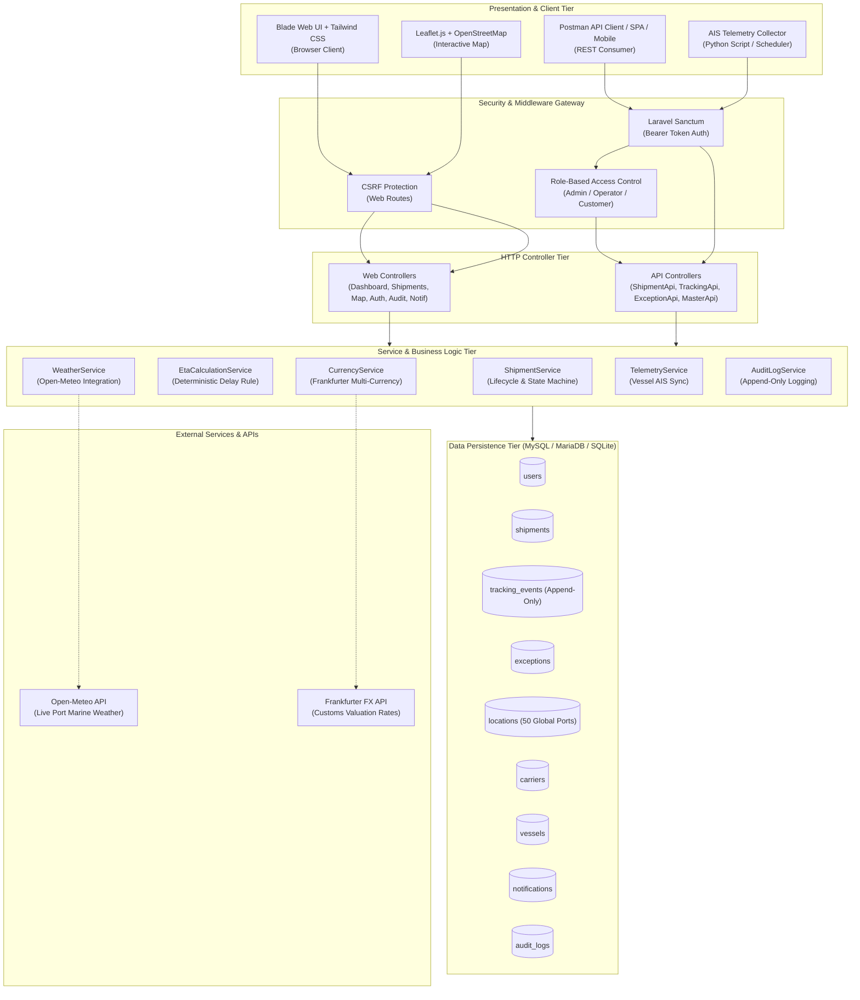
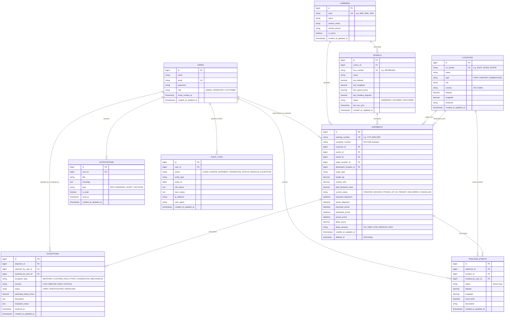
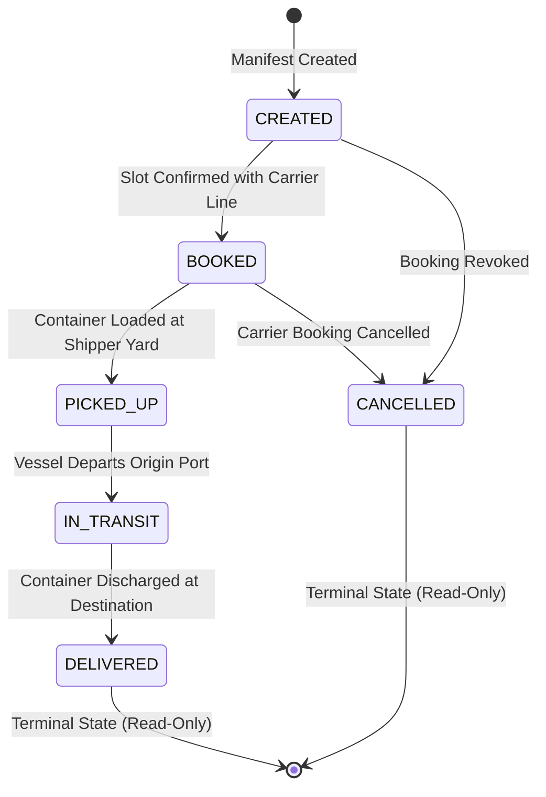

# CargoTrace — Architecture & Entity-Relationship Documentation (ERD)

This document provides the complete technical architectural design, domain model, database schema, data dictionary, and security specifications for the **CargoTrace Global Maritime Shipment Visibility & Automated Tracking Platform**, in full compliance with the Web Programming 2 final project brief.

---

## 1. System Architecture Diagram

CargoTrace adheres to a clean, decoupled multi-tier Laravel architecture leveraging the **Controller-Service-Repository** design pattern. It enforces strict separation of concerns between HTTP presentation, domain logic, data persistence, and external third-party integrations.

---

## 2. Entity-Relationship Diagram (ERD)

The database schema models global maritime logistics operations with strict foreign key constraints, composite indexing for performant search, and immutable historical tables.

---

## 3. Data Dictionary

### Table: `shipments`
Main operational ledger storing container bookings, voyages, monetary valuations, and automated delay metrics.

| Column | Type | Nullable | Key | Description |
|---|---|---|---|---|
| `id` | `BIGINT UNSIGNED` | No | PK | Auto-increment primary key |
| `tracking_number` | `VARCHAR(64)` | No | UNIQUE | Public tracking identifier (e.g. `CTG-2026-0001`) |
| `container_number` | `VARCHAR(32)` | Yes | INDEX | ISO 6346 container serial (e.g. `MSKU8291024`) |
| `customer_id` | `BIGINT UNSIGNED` | No | FK | References `users.id` (Customer owner) |
| `carrier_id` | `BIGINT UNSIGNED` | No | FK | References `carriers.id` |
| `vessel_id` | `BIGINT UNSIGNED` | Yes | FK | References `vessels.id` |
| `origin_location_id` | `BIGINT UNSIGNED` | No | FK | References `locations.id` (Port of Loading) |
| `destination_location_id` | `BIGINT UNSIGNED` | No | FK | References `locations.id` (Port of Discharge) |
| `cargo_type` | `VARCHAR(255)` | No | - | Goods commodity description |
| `weight_kg` | `DECIMAL(12,2)` | No | - | Total gross weight in kilograms |
| `volume_cbm` | `DECIMAL(10,2)` | No | - | Cubic meters volume capacity |
| `total_declared_value` | `DECIMAL(14,2)` | No | - | Declared valuation in USD for customs and insurance |
| `current_status` | `VARCHAR(32)` | No | INDEX | Current state (`CREATED`, `BOOKED`, `PICKED_UP`, `IN_TRANSIT`, `DELIVERED`, `CANCELLED`) |
| `expected_departure` | `DATETIME` | No | - | Initial contractual departure date/time |
| `actual_departure` | `DATETIME` | Yes | - | Verified departure date/time from origin terminal |
| `expected_arrival` | `DATETIME` | No | - | Initial contractual arrival schedule |
| `estimated_arrival` | `DATETIME` | No | - | Dynamic computed arrival based on current AIS speed/delays |
| `actual_arrival` | `DATETIME` | Yes | - | Verified berthing timestamp at destination port |
| `delay_hours` | `DECIMAL(8,2)` | No | - | Computed deviation in hours from `expected_arrival` |
| `delay_severity` | `VARCHAR(32)` | No | INDEX | Categorization: `ON_TIME`, `LOW`, `MEDIUM`, `HIGH` |
| `created_at` / `updated_at` | `TIMESTAMP` | Yes | - | Standard Laravel audit timestamps |
| `deleted_at` | `TIMESTAMP` | Yes | - | Soft delete timestamp |

---

### Table: `tracking_events`
Append-only chronological history of every physical and operational milestone encountered by the shipment.

| Column | Type | Nullable | Key | Description |
|---|---|---|---|---|
| `id` | `BIGINT UNSIGNED` | No | PK | Primary key |
| `shipment_id` | `BIGINT UNSIGNED` | No | FK | References `shipments.id` (Cascades on delete) |
| `location_id` | `BIGINT UNSIGNED` | Yes | FK | References `locations.id` |
| `created_by_user_id` | `BIGINT UNSIGNED` | Yes | FK | References `users.id` (User who recorded milestone) |
| `status` | `VARCHAR(32)` | No | - | Milestone type (e.g. `IN_TRANSIT`, `BERTHED`, `CUSTOMS_CLEARED`) |
| `latitude` | `DECIMAL(10,7)` | Yes | - | AIS/GPS latitude of the event |
| `longitude` | `DECIMAL(10,7)` | Yes | - | AIS/GPS longitude of the event |
| `event_time` | `DATETIME` | No | INDEX | Exact timestamp when physical event occurred |
| `description` | `TEXT` | No | - | Human-readable explanation of the milestone |
| `created_at` / `updated_at` | `TIMESTAMP` | Yes | - | Immutability timestamps |

---

### Table: `locations`
Master registry of 50 premier global container ports mapped with official UN/LOCODE codes and precise GPS coordinates.

| Column | Type | Nullable | Key | Description |
|---|---|---|---|---|
| `id` | `BIGINT UNSIGNED` | No | PK | Primary key |
| `un_locode` | `VARCHAR(10)` | No | UNIQUE | 5-letter UN/LOCODE (e.g. `IDJKT`, `SGSIN`, `NLRTM`, `USLAX`) |
| `name` | `VARCHAR(255)` | No | - | Full official port or terminal name |
| `type` | `VARCHAR(32)` | No | - | Location type: `PORT`, `AIRPORT`, `INLAND_CONTAINER_DEPOT` |
| `city` | `VARCHAR(128)` | No | - | Municipality / Port city |
| `country` | `VARCHAR(2)` | No | INDEX | ISO 3166-1 alpha-2 country code (`ID`, `SG`, `NL`, `US`, etc.) |
| `latitude` | `DECIMAL(10,7)` | No | - | GPS Latitude coordinates |
| `longitude` | `DECIMAL(10,7)` | No | - | GPS Longitude coordinates |
| `timezone` | `VARCHAR(64)` | No | - | IANA timezone string (e.g. `Asia/Jakarta`, `Europe/Amsterdam`) |

---

## 4. State Machine: Shipment Lifecycle

Status transitions follow strict state machine rules implemented in `ShipmentService.php`:

- **Forward Determinism:** Status cannot jump backwards (e.g. `IN_TRANSIT` cannot return to `CREATED`).
- **Terminal Immutability:** Once marked `DELIVERED` or `CANCELLED`, the record enters a read-only terminal state.
- **Append-Only Tracking:** Every status transition automatically appends a new immutable row into `tracking_events`.

---

## 5. Security & Role-Based Access Control (RBAC) Matrix

| Feature / Resource | Administrator | Logistics Operator | Customer |
|---|:---:|:---:|:---:|
| View All Shipments | ✅ Yes | ✅ Yes | ❌ (Own Shipments Only) |
| Create New Shipment Manifest | ✅ Yes | ✅ Yes | ❌ (Forbidden) |
| Transition Shipment Status | ✅ Yes | ✅ Yes | ❌ (Forbidden) |
| Append Tracking Events | ✅ Yes | ✅ Yes | ❌ (Forbidden) |
| Report & Resolve Exceptions | ✅ Yes | ✅ Yes | ❌ (View-Only on Own Shipments) |
| Manage Master Data (Ports, Carriers) | ✅ Yes | ❌ (Read-Only) | ❌ (Read-Only) |
| Access Regulatory Audit Trail (`/audit-logs`) | ✅ Yes | ❌ (Forbidden 403) | ❌ (Forbidden 403) |
| Soft Delete Records | ✅ Yes | ❌ (Forbidden) | ❌ (Forbidden) |
| Mandatory Logout on Account Switching | ✅ Enforced | ✅ Enforced | ✅ Enforced |
